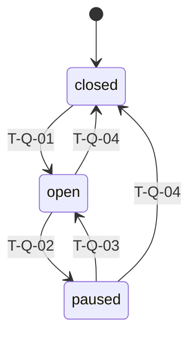
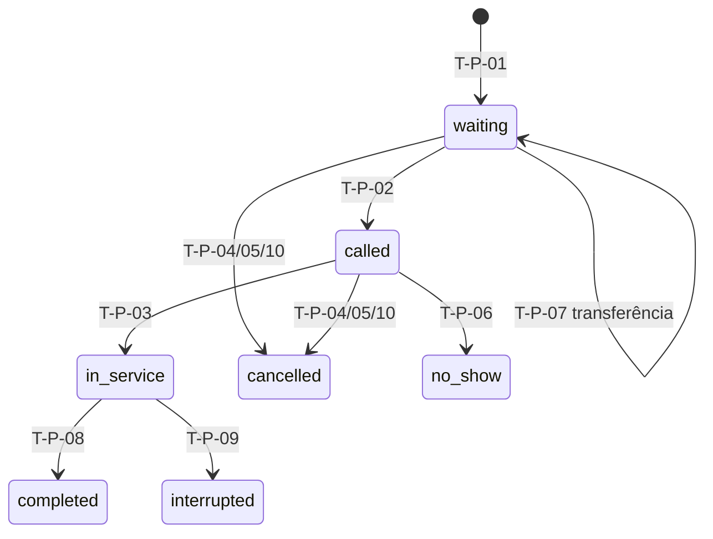
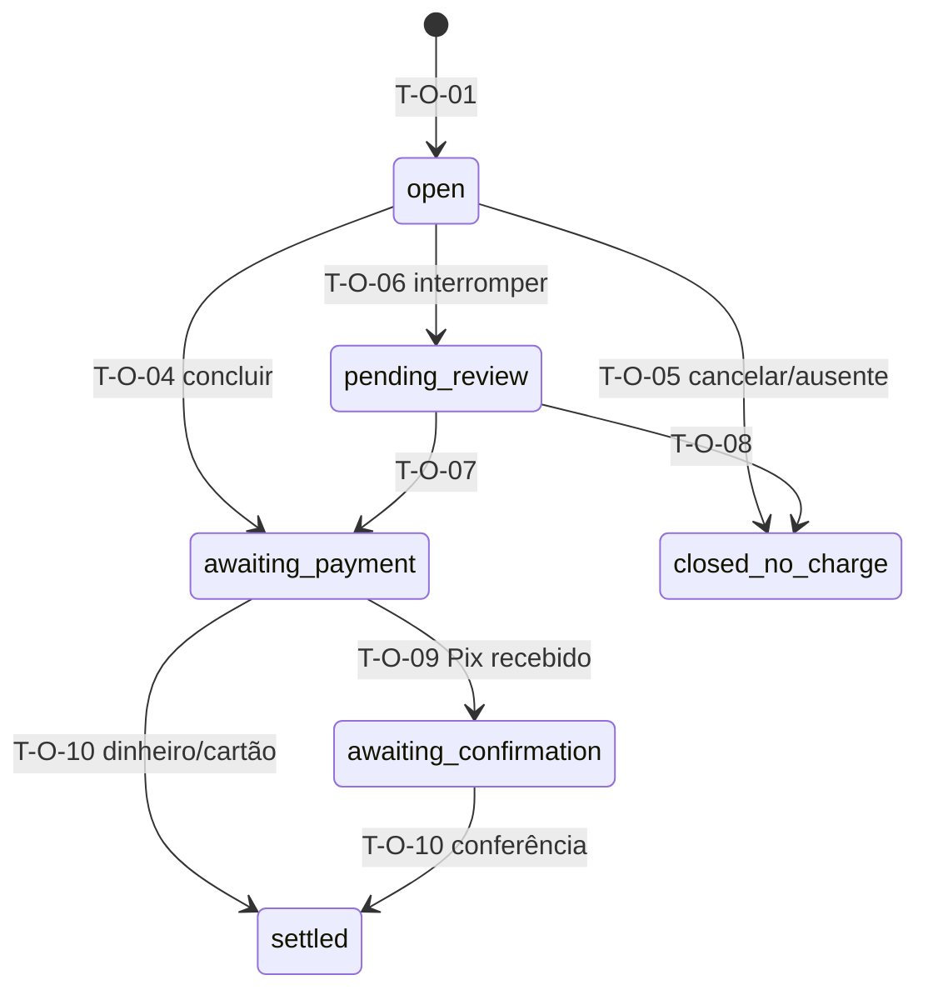
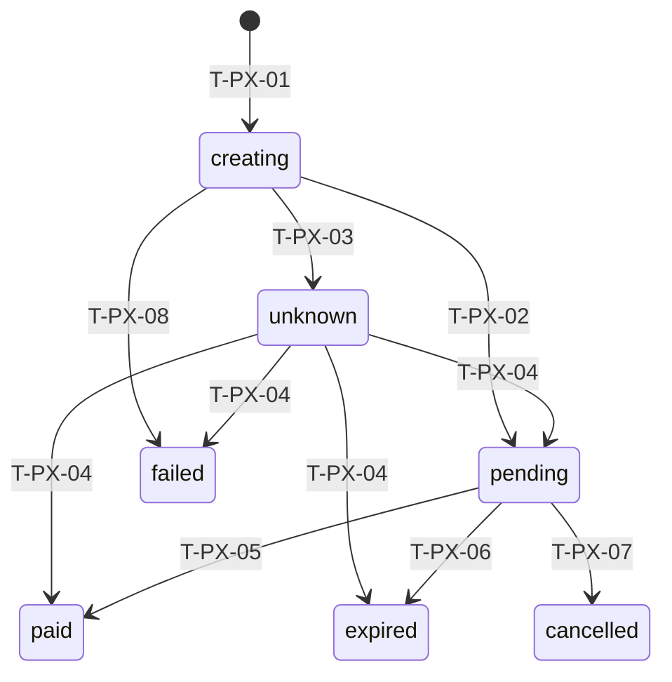
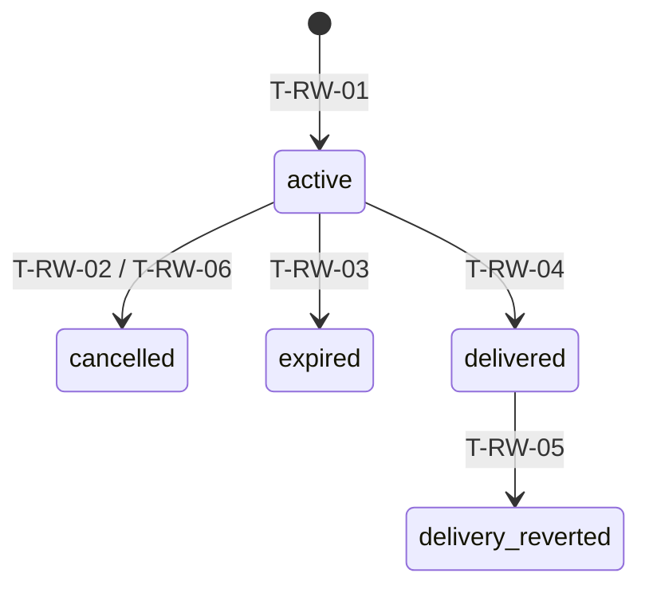

# Matriz de transições de estado

Cada linha é uma mudança de estado permitida. **Tudo que não está aqui é proibido** e responde `409 invalid_transition` (ou código mais específico) sem alterar nada.
Nomes de estado são os códigos da API (inglês); a tradução está em cada seção. Regras em [regras.md](regras.md); contrato em [contrato/openapi.yaml](contrato/openapi.yaml).

## Por que há várias máquinas separadas

Terminar o corte **não** significa que o dinheiro entrou. Por isso:

| Máquina | Responde à pergunta | Exemplo |
|---|---|---|
| Fila (`QueueStatus`) | A fila do profissional aceita gente/chamadas? | `paused` |
| Participação (`ParticipationStatus`) | Onde a pessoa está na jornada da cadeira? | `completed` libera a cadeira |
| Comanda (`OrderStatus`) | Qual a situação financeira da visita? | `awaiting_payment` mesmo com participação `completed` |
| Cobrança Pix (`PixChargeStatus`) | O que aconteceu com o pedido ao provedor? | `unknown` após timeout |
| Recebimento (`ReceiptStatus`) | Dinheiro que entrou foi conferido pela equipe? | Pix `registered` → `conferred` |
| Estorno (`RefundStatus`) | Devolução foi confirmada com evidência? | `under_review` |
| Reserva de prêmio (`ReservationStatus`) | Prêmio está travado, entregue, vencido? | `active` por 24 h |

## Legenda

**Idempotência**
- **IK** — `Idempotency-Key` por ator + operação (24 h): repetição devolve a mesma resposta, sem novo efeito; mesma chave com corpo diferente → `422 idempotency_key_reused`.
- **VE** — versão esperada (`expected_version`): versão diferente → `409 version_conflict` + `current`.
- **UQ(…)** — restrição única no banco que impede duplicata mesmo com chaves diferentes.
- **NAT** — idempotência natural: aplicar de novo não cria registro novo (ex.: evento de provedor deduplicado pelo ID externo).
- **ÚNICA-VEZ(…)** — efeito colateral com chave de origem única (ex.: crédito de pontos por comanda).

**Auditoria** (tabela `audit_event`, sem e-mail/nick/telefone; ator por pseudônimo interno)
- **A** — registra ator, transição, estados de/para, `request_id`.
- **A+M** — idem, com motivo obrigatório.
- **A+E** — idem, com evidência (referência externa ou nota) obrigatória.
- **—** — sem auditoria de negócio (apenas log técnico).

**Ator** — `visitante`, `cliente` (conta), `profissional` (contexto staff, vínculo ativo), `dono` (contexto staff, vínculo ativo), `provedor` (notificação autenticada), `sistema` (worker), `operador` (linha de comando controlada). Escopos como em [contrato/convencoes.md §12](contrato/convencoes.md).

---

## 1. Fila do profissional (`QueueStatus`)

Estados: `closed` (fechada, inicial), `open` (aberta), `paused` (pausada).

| ID | De → Para | Ator | Pré-condições | Efeito | Idempotência | Auditoria | Erro esperado | Contrato |
|---|---|---|---|---|---|---|---|---|
| T-Q-01 | closed → open | dono (establishment) | Profissional `active` | Aceita entradas e chamadas | IK + VE | A | `professional_inactive`, `version_conflict` | `openQueue` |
| T-Q-02 | open → paused | dono | — | Bloqueia entradas e chamadas; permite iniciar quem já foi chamado e concluir atendimento | IK + VE | A | `invalid_transition`, `version_conflict` | `pauseQueue` |
| T-Q-03 | paused → open | dono | Profissional `active` | Volta a aceitar | IK + VE | A | `professional_inactive`, `version_conflict` | `openQueue` |
| T-Q-04 | open/paused → closed | dono | **Zero** participações `waiting` ou `called` na fila (transferir ou cancelar antes) | Bloqueia entradas e chamadas; `in_service` pode ser concluído/interrompido | IK + VE | A | `queue_has_pending_participants`, `version_conflict` | `closeQueue` |
| T-Q-05 | (sem mudança) sinal de indisponibilidade | profissional (own_queue) | — | Marca/desmarca sinal para o dono; **não** muda estado da fila | IK | A | — | `signalAvailability` |

Invariantes: abrir/pausar/fechar só o dono (R-FILA-07). Entrar exige `open`; `callNext` exige `open`; `startService` aceita `open`, `paused` ou `closed`.

---

## 2. Participação (`ParticipationStatus`)

Estados: `waiting` (aguardando), `called` (chamado), `in_service` (em atendimento), `completed` (concluído), `cancelled` (cancelado), `no_show` (ausente), `interrupted` (interrompido). Ativos = `waiting`, `called`, `in_service`.

| ID | De → Para | Ator | Pré-condições | Efeito | Idempotência | Auditoria | Erro esperado | Contrato |
|---|---|---|---|---|---|---|---|---|
| T-P-01 | ∅ → waiting | visitante / cliente (self) | Fila `open`; profissional `active`; 1–10 serviços **ativos**, distintos e **habilitados** para o profissional; identidade sem participação ativa na loja; identidade sem comanda `open`/`pending_review`/`awaiting_payment` na loja; limites de abuso | Cria participação (ordem FIFO = sequência atribuída sob bloqueio da fila), senha do dia, comanda `open` com snapshots dos itens, **snapshot de elegibilidade de pontos** (conta + programa ligado) | IK + UQ(uma participação ativa por identidade/loja) | A | `queue_not_open`, `service_inactive`, `service_not_eligible`, `active_participation_exists`, `pending_order_exists`, `rate_limited` | `createParticipation` |
| T-P-02 | waiting → called | profissional (own_queue) / dono | Fila `open`; **nenhuma** participação `called`/`in_service` na mesma fila; existe `waiting` | Servidor escolhe o primeiro FIFO; grava `called_at` e `tolerance_ends_at = called_at + 10 min` | IK + UQ(uma chamada/atendimento por fila) | A | `queue_not_open`, `professional_busy`, `no_waiting_participant` | `callNext` |
| T-P-03 | called → in_service | profissional (own_queue) / dono | Participação `called` (mesmo após os 10 min, enquanto não marcada ausente); fila em qualquer estado | Grava `started_at` | IK + VE | A | `invalid_transition`, `version_conflict` | `startService` |
| T-P-04 | waiting/called → cancelled | visitante / cliente (visit_owner) | Trabalho não iniciado | Libera posição/cadeira; comanda → `closed_no_charge` (T-O-05); solicitação pendente → `voided`; sem perda de pontos | IK + VE | A | `invalid_transition` (ex.: já `in_service`), `version_conflict` | `cancelParticipation` |
| T-P-05 | waiting/called → cancelled | dono (establishment) | Trabalho não iniciado; **motivo obrigatório** | Igual a T-P-04, `closure_reason = cancelled_by_owner` | IK + VE | A+M | `validation_failed` (sem motivo), `invalid_transition`, `version_conflict` | `cancelParticipation` |
| T-P-06 | called → no_show | profissional (own_queue) / dono | `now ≥ tolerance_ends_at` (relógio do servidor) | Libera cadeira; comanda → `closed_no_charge`; sem punição; retorno exige nova entrada (T-P-01) | IK + VE | A | `tolerance_not_elapsed`, `invalid_transition`, `version_conflict` | `markNoShow` |
| T-P-07 | waiting → waiting (outra fila) | dono | Consentimento do cliente registrado (`customer_consent.given = true`); motivo; fila destino `open`, profissional destino `active`; **todos** os serviços aceitos habilitados no destino; destino ≠ origem | Nova posição no **fim** da fila destino; nova senha do destino; preços aceitos mantidos; estimativa recalculada | IK + VE | A+M | `transfer_consent_required`, `transfer_target_incompatible`, `queue_not_open`, `invalid_transition`, `version_conflict` | `transferParticipation` |
| T-P-08 | in_service → completed | profissional (own_queue) / dono | Sem solicitação `pending`; cada item aceito com resultado (`performed`/`not_performed`+motivo); ≥1 `performed` | Libera cadeira; comanda fecha valor (T-O-04) | IK + VE (participação e comanda) | A | `change_request_pending`, `performed_item_required`, `version_conflict` | `completeService` |
| T-P-09 | in_service → interrupted | profissional (own_queue) / dono | Motivo; resultado de cada item (`fully_performed`/`partially_performed`/`not_started`) | Libera cadeira; comanda → `pending_review` (T-O-06); solicitação pendente → `voided`; **sem pontos** | IK + VE (ambas) | A+M | `validation_failed`, `version_conflict` | `interruptService` |
| T-P-10 | waiting/called → cancelled | sistema (exclusão de conta) | Exclusão solicitada pelo titular (T-AC-03) | Igual a T-P-04 com `closure_reason = cancelled_by_account_deletion` | ÚNICA-VEZ(exclusão, participação) | A | — | `requestAccountDeletion` |

Invariantes no banco:
- Índice único parcial: `(establishment_id, identity_id) WHERE status IN ('waiting','called','in_service')`.
- Índice único parcial: `(queue_id) WHERE status IN ('called','in_service')` — uma cadeira, uma pessoa.
- Ordem FIFO: `(queue_id, queue_seq)` com `queue_seq` atribuído com a linha da fila bloqueada (`SELECT … FOR UPDATE`); desempate determinístico.
- Estados finais (`completed`, `cancelled`, `no_show`, `interrupted`) não mudam mais. `interrupted` continua `interrupted` mesmo após acerto financeiro.

---

## 3. Comanda (`OrderStatus`) e itens (`OrderItemStatus`)

Estados da comanda: `open` (aberta — serviços em definição), `pending_review` (aguardando revisão do dono após interrupção), `awaiting_payment` (valor fechado > 0, falta receber), `awaiting_confirmation` (recebido por Pix, falta conferência), `settled` (encerrada: recebida integralmente e conferida), `closed_no_charge` (encerrada sem valor).
Estados do item: `accepted`, `performed`, `not_performed`, `removed`.

| ID | De → Para | Ator | Pré-condições | Efeito | Idempotência | Auditoria | Erro esperado | Contrato |
|---|---|---|---|---|---|---|---|---|
| T-O-01 | ∅ → open | (junto com T-P-01) | Ver T-P-01 | Itens `accepted` com snapshot de nome, preço, duração, pontos; total calculado no servidor | (de T-P-01) | A | (de T-P-01) | `createParticipation` |
| T-O-02 | open → open (nova versão) | visitante / cliente (visit_owner) | Participação `waiting`; ≥1 serviço; sem duplicado; serviços novos ativos e habilitados; itens existentes mantidos preservam snapshot | Substitui conjunto; item retirado → `removed`; recalcula total e estimativa | IK + VE | A | `order_not_editable` (já chamado), `order_requires_item`, `duplicate_service`, `service_inactive`, `service_not_eligible`, `version_conflict` | `replaceOrderItems` |
| T-O-03 | open → open (nova versão) | profissional (own_attendance) / dono | Participação `waiting`/`called`/`in_service`; sem solicitação `pending`; item `performed` não pode ser retirado; motivo quando ator é equipe | Igual a T-O-02, autor = equipe | IK + VE | A+M | `change_request_pending`, `item_already_performed`, `order_requires_item`, `version_conflict` | `replaceOrderItems` |
| T-O-04 | open → awaiting_payment | (junto com T-P-08) | Ver T-P-08 | Itens `performed` → cobrados; `not_performed` → zero; **total congelado** (`total_frozen_at`); pagamento começa separado | (de T-P-08) | A | (de T-P-08) | `completeService` |
| T-O-05 | open → closed_no_charge | (junto com T-P-04/05/06/10) | Trabalho não iniciado | `closure_reason` preenchido; sem cobrança, sem recebimento fictício, sem pontos | (da origem) | A | — | `cancelParticipation`, `markNoShow`, `requestAccountDeletion` |
| T-O-06 | open → pending_review | (junto com T-P-09) | Ver T-P-09 | Itens recebem resultado informado pelo profissional; aguarda dono | (de T-P-09) | A+M | — | `interruptService` |
| T-O-07 | pending_review → awaiting_payment | dono | Revisão com nota; resultado final por item; soma dos `fully_performed` > 0 | Só `fully_performed` cobrado pelo preço aceito; parcial/não iniciado = 0; valor congelado | IK + VE | A+M | `validation_failed`, `version_conflict` | `closeInterruptedOrder` |
| T-O-08 | pending_review → closed_no_charge | dono | Revisão com nota; soma = 0 | `closure_reason = interruption_zero_total`; sem cobrança | IK + VE | A+M | `version_conflict` | `closeInterruptedOrder` |
| T-O-09 | awaiting_payment → awaiting_confirmation | sistema/provedor (via T-RC-02) | Recebimentos `principal` cobrem o devido e algum Pix não conferido | — | NAT | A | — | `receiveAbacatePayWebhook` |
| T-O-10 | awaiting_payment / awaiting_confirmation → settled | profissional (own_attendance) / dono (via T-RC-01 ou T-RC-03) | Recebimentos `principal` = devido e **todos** conferidos | Encerra comanda; dispara crédito de pontos se elegível (T-LG-01) | IK + NAT | A | `order_not_payable` | `registerInPersonReceipt`, `conferReceipt` |
| T-O-11 | awaiting_payment / awaiting_confirmation / settled → recalculado | dono | Motivo; reautenticação; **nenhuma** cobrança Pix `creating`/`pending`/`unknown` (cancelar/expirar antes); só por item (retirar cobrança de item, incluir serviço feito com preço atual) | Nova versão do total; se recebido > novo devido → pendência `adjustment_excess`; se recebido < novo devido → volta a `awaiting_payment` | IK + VE | A+M | `pix_charge_active`, `pix_charge_outcome_unknown`, `reauthentication_required`, `version_conflict` | `adjustClosedOrder` |
| T-O-12 | (sem mudança) escolha do meio | visitante / cliente (visit_owner), profissional / dono | Comanda `awaiting_payment`; sair de Pix com cobrança ativa exige `acknowledge_active_pix` | Registra meio; se havia Pix ativo → tentativa de cancelamento (T-PX-07) + pendência `active_pix_on_method_switch` | IK + VE | A | `order_not_payable`, `pix_charge_active` (sem ciência), `version_conflict` | `choosePaymentMethod` |
| T-O-13 | item accepted → performed | profissional (own_attendance) / dono | Participação `in_service` | Item não pode mais ser removido pelo cliente | IK + VE | A | `invalid_transition`, `version_conflict` | `markItemPerformed` |

Invariantes: cada `service_id` no máximo uma vez entre itens não removidos (índice único parcial); total = soma de `unit_price` dos itens cobráveis (verificado em teste e recalculado no servidor); mudanças do catálogo não tocam itens existentes.

---

## 4. Solicitação de alteração (`ChangeRequestStatus`)

Estados: `pending`, `approved`, `rejected`, `voided`.

| ID | De → Para | Ator | Pré-condições | Efeito | Idempotência | Auditoria | Erro esperado | Contrato |
|---|---|---|---|---|---|---|---|---|
| T-CR-01 | ∅ → pending | visitante / cliente (visit_owner) | Participação `called`/`in_service`; nenhuma outra `pending` na comanda; remoções só de itens `accepted` (não `performed`); inclusões ativas, habilitadas, sem duplicar; resultado mantém ≥1 item | Guarda pedido; **total aceito não muda** | IK + VE + UQ(uma pendente por comanda) | A | `change_request_pending`, `item_already_performed`, `service_not_eligible`, `order_requires_item`, `version_conflict` | `createChangeRequest` |
| T-CR-02 | pending → approved | profissional (own_attendance) / dono | Itens a remover ainda não `performed` | Aplica nova versão da comanda com autor, instante e versão | IK + VE | A | `item_already_performed`, `version_conflict` | `approveChangeRequest` |
| T-CR-03 | pending → rejected | profissional (own_attendance) / dono | — | Comanda fica na versão anterior; cliente é avisado (evento) | IK + VE | A | `version_conflict` | `rejectChangeRequest` |
| T-CR-04 | pending → voided | sistema | Participação cancelada, ausente ou interrompida | Pedido deixa de valer | ÚNICA-VEZ | A | — | `cancelParticipation`, `markNoShow`, `interruptService` |

---

## 5. Cobrança Pix (`PixChargeStatus`)

Estados: `creating`, `pending` (QR emitido), `unknown` (resultado da criação desconhecido), `paid`, `expired`, `cancelled`, `failed`. Ativos = `creating`, `pending`, `unknown`.

| ID | De → Para | Ator | Pré-condições | Efeito | Idempotência | Auditoria | Erro esperado | Contrato |
|---|---|---|---|---|---|---|---|---|
| T-PX-01 | ∅ → creating | visitante / cliente (visit_owner), profissional / dono | Comanda `awaiting_payment`, devido > 0; **nenhuma** cobrança ativa; integração habilitada no ambiente | Grava tentativa **antes** de chamar o provedor (valor = devido do servidor) | IK + UQ(uma ativa por comanda) | A | `order_not_payable`, `pix_charge_active`, `pix_charge_outcome_unknown`, `provider_unavailable` | `createPixCharge` |
| T-PX-02 | creating → pending | sistema | Provedor respondeu com cobrança válida (valor confere) | Guarda ID externo, `br_code`, `expires_at` | NAT | A | — | `createPixCharge` (201) |
| T-PX-03 | creating → unknown | sistema | Timeout/erro ambíguo na criação | Interface mostra "verificando pagamento"; worker reconcilia; **não** permite nova tentativa | NAT | A | — | `createPixCharge` (202) |
| T-PX-04 | unknown → pending/paid/expired/failed | sistema (worker) | Consulta autenticada ao provedor (backoff com limite); sem resposta após limite → pendência `charge_outcome_unresolved` | Resolve situação real | NAT | A | — | (worker) |
| T-PX-05 | pending → paid | provedor (provider_signature) / sistema (consulta) | Evidência autenticada; cobrança, valor, moeda e recebedor conferem | Cria recebimento (T-RC-02) | NAT(ID do evento externo) | A+E | `webhook_unauthenticated` (dispara consulta) | `receiveAbacatePayWebhook` |
| T-PX-06 | pending → expired | sistema / provedor | Prazo do provedor vencido e confirmado | Permite nova cobrança; pagamento tardio vira T-RC-04 | NAT | A | — | `receiveAbacatePayWebhook` |
| T-PX-07 | pending → cancelled | profissional (own_attendance) / dono, ou sistema após T-O-12 | Provedor suporta e **confirma** cancelamento; sem suporte/sem confirmação → continua `pending` com `cancel_requested_at` | Libera nova cobrança/meio | IK + NAT | A+M | `invalid_transition`, `provider_unavailable` | `cancelPixCharge` |
| T-PX-08 | creating → failed | sistema | Provedor recusou de forma definitiva (sem cobrança criada) | Permite nova tentativa | NAT | A | — | `createPixCharge` |

Nunca: botão "já paguei", comprovante, imagem ou retorno do navegador mudam o estado de uma cobrança.

---

## 6. Recebimento e conferência (`ReceiptStatus`, `ReceiptClassification`)

Estados: `registered` (registrado, aguarda conferência) → `conferred` (conferido). Classificação: `principal` (cobre o devido) ou `excess` (duplicado, tardio ou divergente). Recebimentos nunca são apagados.

| ID | De → Para | Ator | Pré-condições | Efeito | Idempotência | Auditoria | Erro esperado | Contrato |
|---|---|---|---|---|---|---|---|---|
| T-RC-01 | ∅ → conferred (dinheiro/maquininha) | profissional (own_attendance) / dono | Comanda `awaiting_payment`; `amount_cents` = devido; sem Pix ativo; dinheiro: `cash_tendered ≥ devido` | Cria **dois registros**: recebimento e conferência; troco = entregue − devido; receita = devido; comanda → `settled` | IK + VE | A | `payment_amount_mismatch`, `pix_charge_active`, `order_not_payable`, `version_conflict` | `registerInPersonReceipt` |
| T-RC-02 | ∅ → registered (Pix) | provedor / sistema | Ver T-PX-05 | Recebimento `principal` se cobre o devido de comanda aberta a pagamento; comanda → `awaiting_confirmation` (T-O-09); **não volta a "não pago"** | NAT(ID externo) | A+E | — | `receiveAbacatePayWebhook` |
| T-RC-03 | registered → conferred | profissional (own_attendance) / dono | Recebimento Pix `registered` | Registra conferência; se tudo coberto e conferido → comanda `settled` (T-O-10) | IK + NAT | A | `invalid_transition` | `conferReceipt` |
| T-RC-04 | ∅ → registered como `excess` | provedor / sistema | Pagamento duplicado, tardio (cobrança `expired`/`cancelled` ou comanda já coberta) ou valor divergente | Registra mesmo assim; abre pendência (`duplicate_receipt`/`late_receipt`/`amount_mismatch`); valor divergente não encerra comanda | NAT(ID externo) | A+E | — | `receiveAbacatePayWebhook` |

---

## 7. Estorno (`RefundStatus`)

Estados: `requested`, `processing`, `unknown`, `under_review`, `confirmed`, `failed`. No MVP: **integral por recebimento**.

| ID | De → Para | Ator | Pré-condições | Efeito | Idempotência | Auditoria | Erro esperado | Contrato |
|---|---|---|---|---|---|---|---|---|
| T-RF-01 | ∅ → requested | dono | Reautenticação; motivo; recebimento sem estorno ativo/confirmado; valor = recebido ainda não devolvido | Registra intenção (não altera saldo) | IK + UQ(um estorno ativo por recebimento) | A+M | `refund_not_allowed`, `refund_exceeds_available`, `reauthentication_required` | `requestRefund` |
| T-RF-02 | requested → processing | sistema | Recebimento Pix e provedor suporta estorno via API | Chama provedor | NAT | A | `provider_unavailable` | `requestRefund` |
| T-RF-03 | processing → confirmed | provedor / sistema (consulta) | Evidência do provedor | Atualiza devolvido; se recebimento `principal` → reversão de pontos (T-LG-02) | NAT | A+E | — | `receiveAbacatePayWebhook` |
| T-RF-04 | processing → unknown → under_review / failed | sistema | Timeout/ambíguo → `unknown` → consulta; sem resolução → `under_review`; recusa confirmada → `failed` | Pendência `refund_under_review` | NAT | A | — | `receiveAbacatePayWebhook` |
| T-RF-05 | requested → under_review | sistema | Dinheiro/maquininha, ou provedor sem estorno via API, ou caso parcial | Pendência para o dono documentar | NAT | A | — | `requestRefund` |
| T-RF-06 | under_review → confirmed | dono | Reautenticação; evidência documentada | Igual a T-RF-03 (`evidence = owner_documented`) | IK | A+E | `invalid_transition` | `confirmRefundManually` |
| T-RF-07 | under_review → failed | dono | Reautenticação; evidência | Nada é devolvido; recebimento intacto | IK | A+E | `invalid_transition` | `markRefundFailed` |

Corrida confirmação × estorno: estorno exige recebimento existente e conferido ou registrado; bloqueio de linha no recebimento serializa as duas operações.

---

## 8. Pendência financeira (`FinancialIssueStatus`)

| ID | De → Para | Ator | Pré-condições | Efeito | Idempotência | Auditoria | Erro esperado | Contrato |
|---|---|---|---|---|---|---|---|---|
| T-FI-01 | ∅ → open | sistema | Duplicidade, tardio, divergência, cobrança não resolvida, estorno em revisão, troca de Pix ativo, excesso por ajuste | Aparece no painel do dono | UQ(tipo, origem) | A | — | (vários) |
| T-FI-02 | open → resolved | dono | Nota de resolução; para excesso: estorno do recebimento excedente confirmado **ou** nota explicando devolução presencial documentada | Sai do painel; **não** altera nem apaga recebimentos | IK | A+M | `invalid_transition` | `resolveFinancialIssue` |

---

## 9. Fidelidade

### 9.1 Programa

| ID | De → Para | Ator | Pré-condições | Efeito | Idempotência | Auditoria | Erro esperado | Contrato |
|---|---|---|---|---|---|---|---|---|
| T-LP-01 | disabled → enabled | dono | — (padrão é desligado) | Novas visitas de conta passam a ser elegíveis | IK + VE | A | `version_conflict` | `updateLoyaltyProgram` |
| T-LP-02 | enabled → disabled | dono | — | Sem novos acúmulos em **novas** visitas e sem novas reservas; saldo, consulta, reservas ativas e créditos já prometidos preservados | IK + VE | A | `version_conflict` | `updateLoyaltyProgram` |

### 9.2 Razão de pontos (lançamentos imutáveis)

Saldo = soma de `balance_delta`; retido = soma de `held_delta`; disponível = saldo − retido.

| ID | Lançamento | Ator | Pré-condições | Efeito | Idempotência | Auditoria | Erro esperado | Contrato |
|---|---|---|---|---|---|---|---|---|
| T-LG-01 | `credit` (+saldo) | sistema | Comanda `settled`; participação `completed`; identidade = conta; snapshot elegível na entrada | Soma dos pontos snapshot dos itens `performed` | ÚNICA-VEZ(comanda, credit) | A | — | `registerInPersonReceipt`, `conferReceipt` |
| T-LG-02 | `credit_reversal` (−saldo) | sistema | Estorno confirmado do recebimento `principal` de comanda creditada | Reverte o crédito daquela comanda; saldo pode ficar negativo | ÚNICA-VEZ(comanda, reversal) | A | — | `confirmRefundManually`, `receiveAbacatePayWebhook` |
| T-LG-03 | `account_closure` (−saldo restante) | sistema | Exclusão de conta | Saldo encerrado sem conversão em dinheiro | ÚNICA-VEZ(conta, loja) | A | — | `requestAccountDeletion` |

Estorno de recebimento `excess` **não** gera `credit_reversal`.

### 9.3 Reserva de prêmio (`ReservationStatus`)

Estados: `active`, `delivered`, `expired`, `cancelled`, `delivery_reverted`.

| ID | De → Para | Ator | Pré-condições | Efeito | Idempotência | Auditoria | Erro esperado | Contrato |
|---|---|---|---|---|---|---|---|---|
| T-RW-01 | ∅ → active | cliente (self) | Programa ligado; prêmio ativo na versão aceita; disponível ≥ custo; estoque > 0 (se limitado); sem reserva ativa na loja | Lançamento `hold` (+retido); estoque −1; guarda condições aceitas; `expires_at = +24 h` | IK + UQ(uma ativa por conta/loja) + bloqueio de linha no prêmio | A | `loyalty_program_disabled`, `insufficient_points`, `reward_out_of_stock`, `reward_inactive`, `reservation_already_active`, `version_conflict` | `createRewardReservation` |
| T-RW-02 | active → cancelled | cliente (self) | `active` (também com programa desligado) | `hold_release` (−retido); estoque +1 | IK + VE + ÚNICA-VEZ | A | `invalid_transition` | `cancelRewardReservation` |
| T-RW-03 | active → expired | sistema | `now ≥ expires_at` | `hold_release`; estoque +1 | ÚNICA-VEZ (UPDATE condicional `WHERE status='active'`) | A | — | (worker) |
| T-RW-04 | active → delivered | profissional (establishment_member) / dono | `now < expires_at` (no banco, mesma transação) | `consume` (−saldo, −retido); estoque segue consumido | IK + VE | A | `reservation_expired`, `invalid_transition` | `deliverRewardReservation` |
| T-RW-05 | delivered → delivery_reverted | dono | Motivo | `consume_reversal` (+saldo); estoque +1 | IK + VE + ÚNICA-VEZ | A+M | `invalid_transition` | `revertRewardDelivery` |
| T-RW-06 | active → cancelled | sistema (exclusão de conta) | Exclusão solicitada | Igual a T-RW-02 | ÚNICA-VEZ | A | — | `requestAccountDeletion` |

---

## 10. Catálogo, equipe e loja

| ID | De → Para | Ator | Pré-condições | Efeito | Idempotência | Auditoria | Erro esperado | Contrato |
|---|---|---|---|---|---|---|---|---|
| T-SV-01 | ∅ → active | dono | Preço > 0 em centavos; duração > 0; pontos inteiros ≥ 0; profissionais da mesma loja | Serviço disponível | IK | A | `validation_failed` | `createService` |
| T-SV-02 | active/inactive → nova versão | dono | Mesmas validações | Vale só para inclusões futuras | IK + VE | A | `version_conflict` | `updateService` |
| T-SV-03 | active → inactive | dono | — | Sem novas inclusões; itens aceitos permanecem | IK + VE | A | `version_conflict` | `deactivateService` |
| T-SV-04 | inactive → active | dono | — | Volta ao catálogo | IK + VE | A | `version_conflict` | `reactivateService` |
| T-SV-05 | habilitações | dono | Profissionais da mesma loja | Afeta só novas inclusões/transferências | IK + VE | A | `not_found`, `version_conflict` | `setServiceProfessionals` |
| T-PR-01 | ∅ → active (+fila closed) | dono | Letra de fila única na loja | Cria profissional e sua fila | IK | A | `validation_failed` | `createProfessional` |
| T-PR-02 | active → inactive | dono | Reautenticação; **zero** participações ativas na fila | Vínculo desativado; sessões staff revogadas; SSE encerrado; fila `closed`; comandas antigas seguem com o dono | IK + VE | A+M | `professional_has_active_participations`, `reauthentication_required` | `deactivateProfessional` |
| T-PR-03 | inactive → active | dono | Reautenticação | Vínculo volta; fila continua `closed` | IK + VE | A | `reauthentication_required` | `reactivateProfessional` |
| T-PR-04 | nova versão (nome) | dono | — | Nome exibido muda | IK + VE | A | `version_conflict` | `updateProfessional` |
| T-RD-01 | ∅ → active (prêmio) | dono | Custo inteiro > 0; descrição; instruções; estoque limitado/ilimitado | Prêmio disponível | IK | A | `validation_failed` | `createReward` |
| T-RD-02 | nova versão (prêmio) | dono | — | Reservas existentes mantêm condições aceitas | IK + VE | A | `version_conflict` | `updateReward` |
| T-RD-03 | active → inactive (prêmio) | dono | — | Sem novas reservas; ativas honradas | IK + VE | A | `version_conflict` | `deactivateReward` |
| T-ES-01 | nova versão (loja) | dono | Slug único | Nome/slug/fuso | IK + VE | A | `slug_taken`, `version_conflict` | `updateEstablishment` |

---

## 11. Identidade, sessões, convites e visitante

| ID | De → Para | Ator | Pré-condições | Efeito | Idempotência | Auditoria | Erro esperado | Contrato |
|---|---|---|---|---|---|---|---|---|
| T-AC-01 | ∅ → pending_verification | público | E-mail não usado (resposta igual se usado); senha conforme política | Cria conta sem papel; envia verificação | NAT (resposta genérica) | A | `validation_failed`, `rate_limited` | `registerAccount` |
| T-AC-02 | pending_verification → active | público (token) | Token válido, não usado, ≤ 24 h | Conta ativa; token consumido | ÚNICA-VEZ(token) | A | `token_invalid` | `verifyEmail` |
| T-AC-03 | active → deletion_processing | cliente/profissional/dono (self) | Reautenticação; `confirm_effects`; não ser **dono único** de loja ativa | Revoga sessões; cancela `waiting`/`called` (T-P-10); libera reservas (T-RW-06); encerra saldo (T-LG-03); profissional: vínculos desativados; bloqueios listados | IK + ÚNICA-VEZ(conta) | A | `sole_owner`, `reauthentication_required`, `deletion_in_progress` | `requestAccountDeletion` |
| T-AC-04 | deletion_processing → deleted | sistema | Sem bloqueios (`service_in_progress`, `financial_pending`, `professional_queue_has_participants`) | Anonimiza perfil/credenciais; mantém registros operacionais/financeiros minimizados; evidência sem dados pessoais | ÚNICA-VEZ + retomável | A | — | (worker) |
| T-SS-01 | ∅ → active (sessão) | público | Credenciais válidas; e-mail verificado; contexto `staff` exige vínculo ativo; limite de tentativas por conta e por origem | Cookie HttpOnly; validade conforme contexto | — | A | `invalid_credentials`, `email_not_verified`, `rate_limited` | `login` |
| T-SS-02 | active → revoked | titular | — | Revoga no servidor; SSE encerrado | NAT | A | — | `logout` |
| T-SS-03 | outras sessões → revoked | titular | Senha atual correta | Troca senha; revoga todas as outras sessões | — | A | `invalid_credentials` | `changePassword` |
| T-SS-04 | todas → revoked | público (token de reset) | Token válido | Revoga todas as sessões | ÚNICA-VEZ(token) | A | `token_invalid` | `confirmPasswordReset` |
| T-SS-05 | active → expired | sistema | Inatividade/limite absoluto | Sessão inválida; SSE encerrado | NAT | — | — | (verificação a cada uso) |
| T-SS-06 | reautenticação | titular | Senha correta | `reauth_valid_until = now + 10 min` | — | A | `invalid_credentials`, `rate_limited` | `reauthenticate` |
| T-PW-01 | ∅ → token emitido | público | — (resposta igual exista ou não) | Token aleatório, armazenado em hash, 30 min | NAT | A (se conta existe) | `rate_limited` | `requestPasswordReset` |
| T-PW-02 | token → consumido | público | Token válido, não usado, ≤ 30 min | Nova senha | ÚNICA-VEZ | A | `token_invalid` | `confirmPasswordReset` |
| T-IN-01 | ∅ → pending (convite) | dono | Reautenticação; profissional sem acesso ativo; convite anterior pendente é revogado | Token aleatório em hash, 24 h, enviado por e-mail | IK | A | `reauthentication_required`, `invalid_transition` | `createInvite` |
| T-IN-02 | pending → accepted | público (token) | Token válido, não usado, ≤ 24 h | Vínculo `professional` ativo para a conta | ÚNICA-VEZ(token) | A | `invite_invalid` | `acceptInvite` |
| T-IN-03 | pending → revoked | dono | Pendente | Token inutilizado | IK | A | `invalid_transition` | `revokeInvite` |
| T-IN-04 | pending → expired | sistema | > 24 h | Token inutilizado | NAT | — | — | (verificação no uso) |
| T-VS-01 | ∅ → active (visitante) | público | Loja ativa; nick válido; sem visitante desta loja com visita ativa/pendente no navegador; limites de abuso | Credencial (cookie) + código de recuperação exibido **uma vez** | — (repetir cria outra identidade sem visita) | A | `visitor_visit_in_progress`, `rate_limited` | `createVisitorSession` |
| T-VS-02 | credencial anterior → revoked; nova → active | público (código) | Código válido; ≤ 30 dias da criação; ≤ 24 h após encerramento; tentativas limitadas | Novo cookie; **novo código**; credenciais anteriores revogadas e SSE encerrado | ÚNICA-VEZ(código) | A | `recovery_code_invalid`, `rate_limited` | `recoverVisitorSession` |
| T-VS-03 | active → revoked | visitante (self) | — | Revoga credencial; **não** cancela a visita | NAT | A | — | `endVisitorSession` |
| T-VS-04 | active → expired | sistema | 7 dias sem uso, 30 dias da criação ou 24 h após encerramento da comanda | Credencial inválida; visita e dívida permanecem para a equipe | NAT | — | — | (verificação a cada uso) |

## 12. Processos controlados (fora da API HTTP)

| ID | Mudança | Ator | Pré-condições | Efeito | Idempotência | Auditoria | Erro esperado | Contrato |
|---|---|---|---|---|---|---|---|---|
| T-OP-01 | Criar loja + convite de dono inicial | operador | Comando de linha controlado, com acesso ao servidor; e-mail informado | Loja criada; convite de dono (24 h, uso único) | ÚNICA-VEZ(slug) | A | slug duplicado | CLI `fila-admin bootstrap` (ADR-0013) |
| T-OP-02 | Transferir administração / encerrar loja | operador, a pedido do dono atual | Identidade do dono confirmada fora de banda; encerramento exige pendências tratadas | Novo dono vinculado ou loja encerrada; nunca loja ativa sem dono | ÚNICA-VEZ | A+M | pendências abertas | CLI `fila-admin transfer-owner` / `close-establishment` (ADR-0013) |
